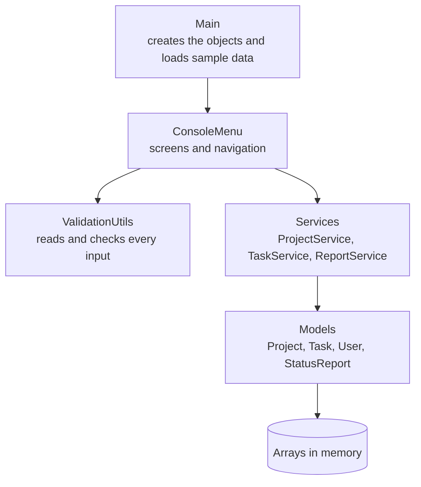
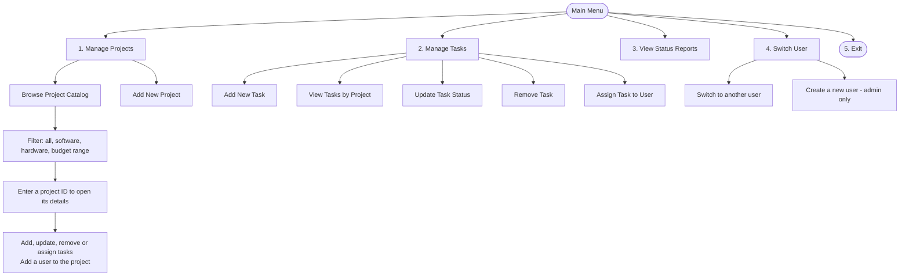
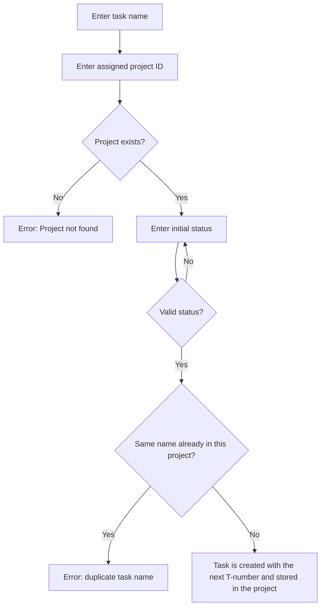
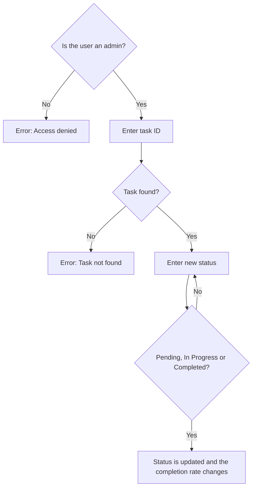
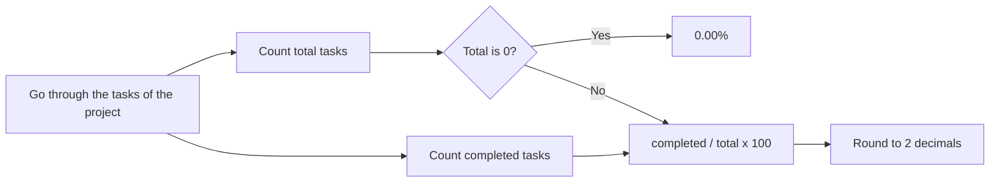
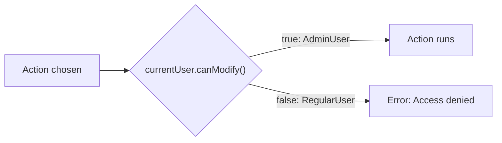

# Task Management System

A console based project and task management system written in Java 21. Users can create projects, add tasks, assign them to people, track task status and see how complete each project is.

All data lives in memory and is stored in plain arrays, so nothing is saved when the program closes. This is the base for later labs, where the arrays will become collections and the data will be saved to files.

## Contents

1. [How to run](#how-to-run)
2. [How the program is organised](#how-the-program-is-organised)
3. [Using the application](#using-the-application)
4. [Roles and permissions](#roles-and-permissions)
5. [Class diagram](#class-diagram)
6. [Features mapped to user stories](#features-mapped-to-user-stories)
7. [Project structure](#project-structure)
8. [More documentation](#more-documentation)

## How to run

**Requirements:** JDK 21 and IntelliJ IDEA Community Edition (or any terminal with `javac`).

In IntelliJ:

1. Open the project folder.
2. Set the project SDK to JDK 21 and mark `src` as the sources root.
3. Run `Main`.

From a terminal, in the project root:

```
javac -encoding UTF-8 -d out src/Main.java src/models/*.java src/interfaces/*.java src/services/*.java src/utils/*.java
java -cp out Main
```

If the box characters show up as question marks, run with `java -Dstdout.encoding=UTF-8 -cp out Main`. In IntelliJ, add `-Dstdout.encoding=UTF-8` to the VM options of the run configuration.

When the program starts you are logged in as **Alice Johnson (Admin)**. **Bob Smith (Regular)** also exists, and five sample projects are already loaded.

## How the program is organised

The code is split in layers. Each layer only talks to the one below it.



| Layer | What it does |
|---|---|
| `Main` | Builds the services, loads five projects, a few tasks and two users, then starts the menu. |
| `ConsoleMenu` | Prints the screens, reads the choices and calls the services. |
| `ValidationUtils` | Keeps asking until the input is valid (numbers, text, IDs, status, email). |
| Services | The actual operations: find, filter, add, update, remove, report. They never read the keyboard. |
| Models | The data and the rules attached to it (for example how a completion percentage is computed). |

## Using the application

### Navigation



Every sub-menu has a way back to the main menu. Typing `0` where it is offered also returns.

### IDs

IDs are shown with a prefix: `P001` for projects, `T001` for tasks, `U001` for users. When the program asks for an ID you can type `P001` or just `1`.

### Adding a task



### Updating a task status



### How the completion rate is computed



The status report repeats this for every project and then averages the percentages. Example for a report with two projects at 75.00% and 50.00%: the average completion is 62.50%.

### Sample session

```
Current User: Alice Johnson (Admin)

Main Menu:
-----------
1. Manage Projects
2. Manage Tasks
3. View Status Reports
4. Switch User
5. Exit

Enter your choice: 3

───────────────────────────────────────────────────────────────────────
PROJECT ID | PROJECT NAME        | TASKS | COMPLETED | PROGRESS (%)
───────────────────────────────────────────────────────────────────────
P001       | Alpha Tracker       |   3   |     1     | 33.33%
P002       | IoT Sensor Kit      |   2   |     1     | 50.00%
...
───────────────────────────────────────────────────────────────────────
AVERAGE COMPLETION: 16.67%
```

## Roles and permissions



| Action | Regular | Admin |
|---|---|---|
| Browse projects, view tasks, view reports | yes | yes |
| Add projects and tasks | yes | yes |
| Update task status, remove tasks | no | yes |
| Assign tasks, add users to projects | no | yes |
| Create users | no | yes |

## Class diagram


The diagram shows the model classes only: the interface, the two abstract classes with their subclasses, and how projects, tasks and users relate. The reasons behind these choices are in [design-decisions.md](docs/design-decisions.md).

## Features mapped to user stories

| Story | What it covers | Where it lives |
|---|---|---|
| US-1.1 Browse projects | Catalog with ID, name, type, team size, budget, description, and filter by type | `Project`, `SoftwareProject`, `HardwareProject`, `ProjectService`, `ConsoleMenu` |
| US-1.2 Search by budget range | Min and max budget, "No projects found" when empty | `ProjectService.getByBudgetRange` |
| US-2.1 Add task to project | Unique task ID, name, initial status, duplicate names refused | `Task`, `Completable`, `TaskService.addTask` |
| US-2.2 Update task status | Find the task by ID, choose an allowed status | `Task.Status`, `TaskService.updateTaskStatus` |
| US-3.1 Create user profiles | Regular and admin users, automatic IDs, role shown when logged in | `User`, `RegularUser`, `AdminUser`, `ConsoleMenu` |
| US-4.1 Completion average | Totals, completed count, percentage rounded to 2 decimals, zero tasks handled | `Project.getCompletionPercentage`, `StatusReport`, `ReportService` |
| US-5.1 Main menu | Numbered options 1 to 5, validated, loops until exit | `ConsoleMenu.start` (do-while with a switch) |

## Project structure

```
src/
  Main.java                  entry point and sample data
  interfaces/
    Completable.java
  models/
    Project.java             abstract
    SoftwareProject.java
    HardwareProject.java
    Task.java
    User.java                abstract
    RegularUser.java
    AdminUser.java
    StatusReport.java
  services/
    ProjectService.java
    TaskService.java
    ReportService.java
  utils/
    ConsoleMenu.java
    ValidationUtils.java
docs/
  class-diagram.png
  design-decisions.md
README.md
```

## More documentation

- [Design decisions](docs/design-decisions.md): why the classes are shaped this way, with diagrams.
