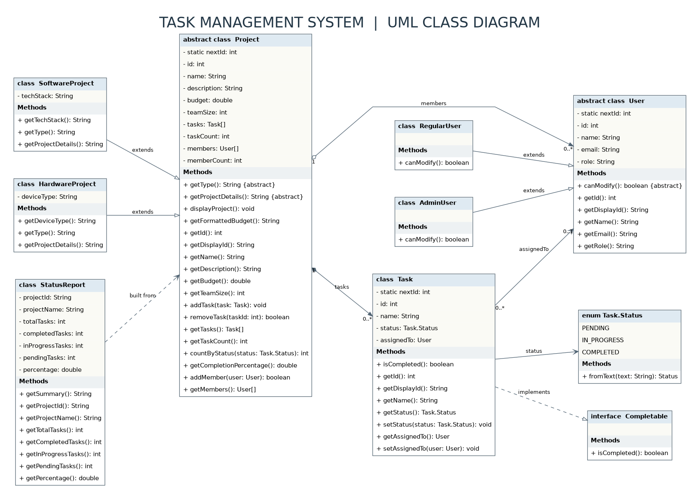
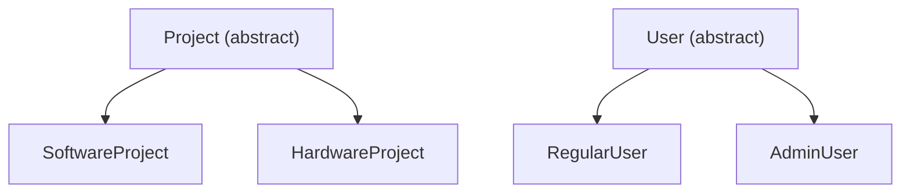
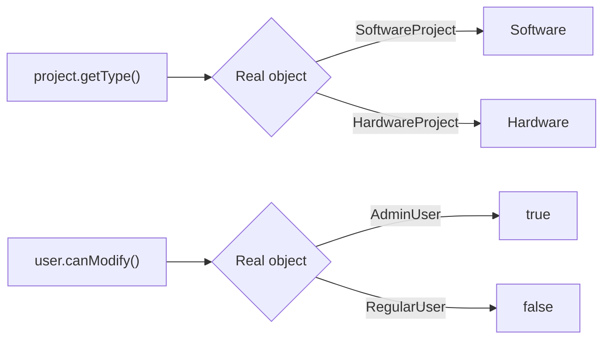
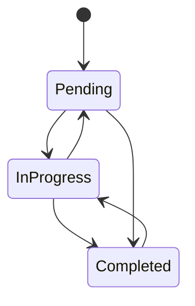
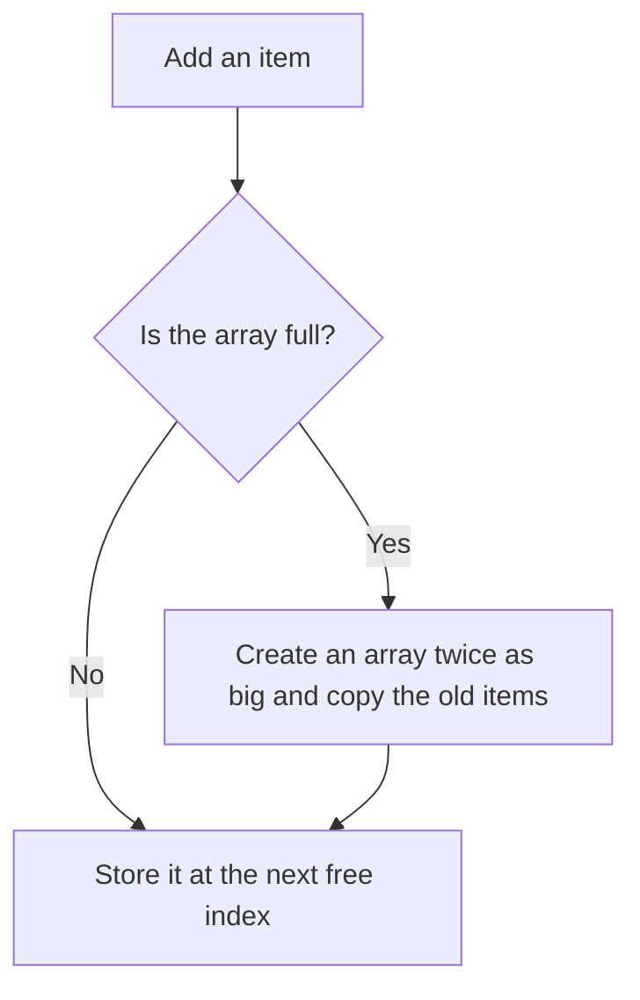
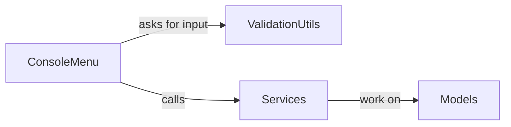
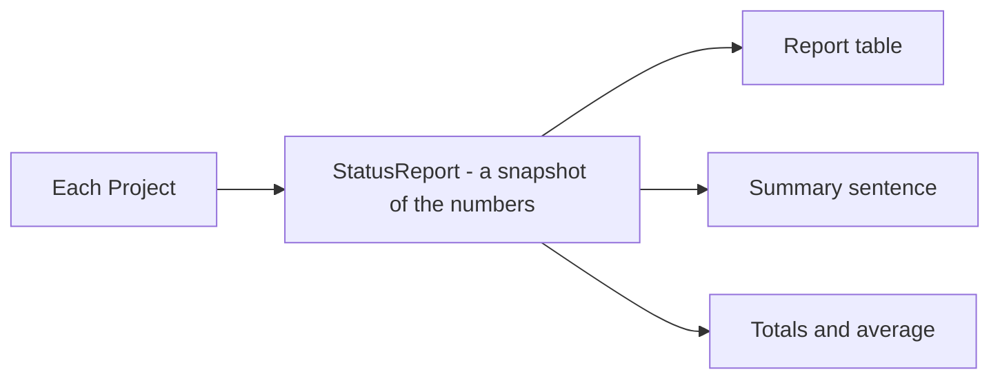

# Design decisions

This page explains why the code is built the way it is. The class diagram is here too, since most of the choices are about how the classes relate.

## Contents

1. [Class diagram](#class-diagram)
2. [Inheritance and abstract classes](#inheritance-and-abstract-classes)
3. [The Completable interface](#the-completable-interface)
4. [Polymorphism](#polymorphism)
5. [Encapsulation](#encapsulation)
6. [Task status as an enum](#task-status-as-an-enum)
7. [Arrays instead of collections](#arrays-instead-of-collections)
8. [IDs](#ids)
9. [Layers: menu, services, models](#layers-menu-services-models)
10. [Reports](#reports)
11. [Role rules](#role-rules)
12. [Known limits and next steps](#known-limits-and-next-steps)

## Class diagram

How to read it:

- A hollow triangle with a solid line is inheritance (`SoftwareProject` extends `Project`).
- A hollow triangle with a dashed line is an interface being implemented (`Task` implements `Completable`).
- A diamond means "owns or holds": a project holds its tasks and its team members.
- A plain arrow means "refers to": a task points to the user it is assigned to and to its status.

## Inheritance and abstract classes

`Project` and `User` are abstract because a plain "project" or "user" never exists on its own here. Each one is always a specific kind.

**Project** holds what every project shares: id, name, description, budget, team size, its tasks and its team members. Two methods are left abstract, so every subclass must answer them:

| Method | `SoftwareProject` | `HardwareProject` |
|---|---|---|
| `getType()` | `Software` | `Hardware` |
| `getProjectDetails()` | `Tech Stack: ...` | `Device Type: ...` |

This is how the screens can show attributes that depend on the project type without testing the type with `instanceof`.

**User** forces each subclass to define `canModify()`. `AdminUser` returns true and `RegularUser` returns false. The menu never asks "is this an admin?", it just asks the user object.

## The Completable interface

`Completable` has one method, `boolean isCompleted()`. `Task` implements it.

Why an interface and not another abstract class: being "completable" is a capability, not a kind of thing. It says nothing about what the object is, only that it can be finished. Anything else that can be finished later (a milestone, a sprint) could implement it and be counted the same way.

## Polymorphism

The same call gives a different result depending on the real object behind it.

- `displayProject()` is written once in `Project` and calls `getType()`, so it prints the right type for every subclass.
- The catalog loops over an array of `Project` and never needs to know which concrete class each one is.
- Role checks go through `canModify()`, so adding a new role later means adding a class, not editing every menu.

## Encapsulation

- Every field in every model is private.
- IDs are `final` and have no setter, so they cannot change after creation.
- `Task` only exposes setters for what really changes: its status and the user it is assigned to.
- `getTasks()` and `getMembers()` return a trimmed copy of the array, so other code cannot damage the internal one.
- Adding and removing tasks goes through `addTask` and `removeTask` on the project.

## Task status as an enum

`Task.Status` is an enum nested inside `Task` with three values: Pending, In Progress and Completed. Compared with a free text field:

- A typo such as "Compleated" can never be stored.
- There is one single place that knows the valid values.
- `Task.Status.fromText` turns what the user typed into the enum, ignoring upper and lower case, and returns nothing when the text is not valid, which triggers the error message.

Any status can be changed to any other status, as the lab does not impose an order.

## Arrays instead of collections

The lab asks for arrays, so projects, tasks, users and team members are all stored in arrays.

- Each owner keeps a counter next to its array. The array is only read up to that counter, so loops do not need null checks.
- Removing a task shifts the later items one step to the left and keeps the array packed.
- A team member array is created with the team size of the project, so the team size is also the maximum number of members.

Searching is a simple loop over the array, which is linear. For this amount of data that is fine and easy to follow. Looking up by id in a map would be the natural improvement when collections are introduced.

## IDs

Each class keeps a `static` counter that goes up every time an object is created, so IDs are unique for the whole run.

| Object | Stored as | Shown as |
|---|---|---|
| Project | 1, 2, 3 | P001, P002, P003 |
| Task | 1, 2, 3 | T001, T002, T003 |
| User | 1, 2, 3 | U001, U002, U003 |

The number is stored as an `int` and only formatted for display. When the program asks for an ID, `ValidationUtils.readId` accepts `P001`, `p001` or `1`.

## Layers: menu, services, models

- **Models** hold data and the rules that belong to the data. For example, a project knows how to compute its own completion percentage.
- **Services** hold the operations across several objects: search the project array, check for a duplicate task name, build the reports. They never read from the keyboard.
- **ConsoleMenu** is the only class that decides what is printed next and which screen follows.
- **ValidationUtils** is the only class that reads raw input, so every prompt keeps asking until the value is valid and the program does not crash on bad input.

Keeping these apart means the screens can change later (for example a graphical interface) without touching the rules.

Users are kept by `ConsoleMenu` itself, because the lab structure has no separate user service. That is the one place where the menu holds data, and it is a good candidate to move into its own service in a later lab.

## Reports

`StatusReport` is built from one project and stores the counts and the percentage at that moment. The table, the summary sentences ("Alpha Tracker is 50.00% complete") and the totals all read from the same snapshot, so the numbers always agree.

- Percentages are rounded to two decimals.
- A project with no tasks shows 0.00%, and there is no division by zero.
- The average completion is the average of the project percentages.

## Role rules

Regular users can view and add. Only admins can update, delete, assign tasks, add users to projects and create users.

The check is done in one small method in the menu, `requireModifyAccess`, so the rule is easy to find and change. Because the check calls `canModify()`, the menu does not depend on the concrete user classes.

## Known limits and next steps

| Limit now | Planned direction |
|---|---|
| Nothing is saved when the program closes | Save to files |
| Fixed arrays that grow by copying | Replace with Java collections |
| Switching user needs no password | Add authentication |
| Per-user performance summary is not built | Add it to the reports |
| Task IDs are looked up by looping | Use a map keyed by id |
